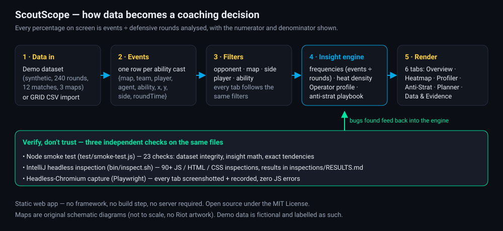

# Devpost Submission Draft — ScoutScope
**Status: DRAFT — NOT submitted. Do not submit without Yu's go-ahead.**
**Hackathon:** Cloud9 x JetBrains: Sky's The Limit Hackathon 2026 — https://cloud9.devpost.com/
**Category:** 1 (VAL/GC): VALORANT Tactical Scouting, Utility Placement & Operator Profiler
**Devpost account:** manes99 (https://devpost.com/manes99)

## Project title
ScoutScope — VALORANT Tactical Scouting for Cloud9 Coaches

## Tagline
Scout smarter: utility heatmaps, Operator tendency profiles and data-backed anti-strats — built with JetBrains IntelliJ IDEA 2025.3 (free core), on real GRID telemetry.

---

## 1. Inspiration

Before every match, Cloud9's VALORANT and Game Changers coaches spend hours
scrubbing VODs to answer one question: *where does the opponent put their
utility?* The answer is always a number — "FURIA's Sova casts Recon Bolt at
A Lobby 15 times in 12 defensive rounds (1.25 per round)" — but getting to
it means pausing, rewinding, and tallying by hand. We built ScoutScope so
that number is one glance away, with the sample size printed next to it, so
a coach can walk into the pre-match meeting with evidence instead of a
hunch. And the numbers are real: every tendency in the tool comes from an
actual VCT match — Cloud9 vs FURIA, 18 July 2025 — not a synthetic demo.

## 2. What It Does

ScoutScope turns real opponent match data into visual, coach-ready tactical
insights. Pick an opponent and a map, and every tab follows the same
filters:

- **Overview** — the top 5 tendencies with hard numbers and sample sizes
  ("Sky Smoke at B Long — 13 placements in 12 defensive rounds, 1.08 per
  round"), plus an Operator snapshot (hold rate, angle mix, timing).
- **Utility Heatmap** — every ability placement plotted on an original
  schematic map, with a density heat overlay and a frequency table.
- **Operator Profiler** — who holds the Operator, how often (OXY: 4 of 12
  Bind rounds), aggressive vs. pixel vs. passive angles, round-time split
  (0–20s / 20–40s / 40s+), and favourite setup spots.
- **Anti-Strat** — each measured tendency turns into a concrete counter
  (e.g. "Break the A Lobby dart before the hit"), with the evidence that
  supports it. Counters are location-specific — Toxic Screen at Mid gets
  a different answer than Toxic Screen at A Short — and every ability in
  the series has its own counter.
- **Planner** — coaches click the map to draw their own setups, save them
  locally, and export them as JSON for the team.
- **Data & Evidence** — the full provenance: series, sample sizes,
  methodology summary, and a **GRID-format CSV import** so coaches can
  load any other match; the analysis engine is data-source agnostic.

## 3. How We Built It

- **Frontend:** vanilla HTML/CSS/JS — no framework, no build step, no
  dependencies. `index.html` + `css/style.css` + `js/app.js` (filters,
  insights engine, renderers, planner, CSV import) + `js/data.js` (map
  schematics, the real-data aggregates, anti-strat playbook).
- **Real data, licence-clean:** the built-in dataset is Cloud9 vs FURIA,
  VCT Americas Stage 2 2025 (series 2819676) — 35 rounds won, 1,013
  ability casts positioned, 8 Operator rounds — pulled from the official
  Cloud9 starter repo (GRID feed + ability supplement + meta CSVs, no
  login or API key). The starter data is proprietary, so only
  **aggregates** are committed (counts by team/map/side/ability/location/
  player); the engine expands them back into rows at runtime with every
  marginal preserved exactly. Extraction: `extract2.py`, documented in
  `METHODOLOGY.md`.
- **JetBrains IntelliJ IDEA 2025.3 (free core):** the project was created
  and developed in it; `.idea/` is committed as evidence, and its headless
  code inspection (`bin/inspect.sh`, 90+ JS/HTML/CSS inspections) is part
  of verification — see `inspections/RESULTS.md`. No paid JetBrains
  product, trial, or licence was used.
- **Verification:** an independent Node smoke test (`test/smoke-test.js`,
  35 checks) re-computes the dataset and the insight math, and a
  headless-Chromium capture (Playwright) screenshots every tab with zero
  JS errors. Details in `METHODOLOGY.md`.

## 4. Challenges We Ran Into

- **An impossible 155%.** The first frequency model (in the original
  synthetic demo data) was linear, so a strong team bias produced a 155%
  placement frequency — a number that cannot exist. The smoke test caught
  it, and the fix was a principled model change, not a clamp: Poisson
  saturation, `p = 1 − exp(−λ)`, which guarantees frequencies stay within
  0–100% no matter how strong the bias is. The demo generator has since
  been replaced by real data, but the lesson stayed: the smoke test
  asserts the top tendency's rate, and real rates can exceed 1.0 per round
  (two charges) — so the tool now reports casts per round, not a capped
  percentage.
- **The feed and the CSVs disagreed about who defended.** The starter
  repo's `games.csv`/`rosters.csv` say Cloud9 defended Haven; the live
  feed says Cloud9 attacked rounds 1–12 and defended 13–18. We trusted
  the primary source and proved it with the Spike: Cloud9's neT carried
  it in round 1 while the feed marks Cloud9 as attacker — only attackers
  carry the Spike. The CSVs list the second-half side; the feed is
  authoritative.
- **A round that started but never ended.** Haven has 19 round starts
  but 18 round wins — round 13 started and produced no result (an 8½
  minute gap before round 14). Its 12 casts are excluded by rule (a round
  counts only if it was won), and the denominator counts won rounds only.
- **The licence forbids committing event rows.** The starter data is
  proprietary — aggregates are fine to commit, extracts are not. So the
  committed dataset holds counts only, and the engine expands them into
  rows at runtime with every marginal preserved exactly (verified by the
  smoke test). The raw files live outside the repo and are git-ignored.
- **A frozen tab highlight.** The app switched tabs but the highlight
  stayed on Overview — invisible to unit tests, caught only when a
  screenshot audit actually looked at the frames. One-line fix
  (`render()` now re-renders the tabs), found by looking, not by testing.
- **A map that didn't fit its own screenshot.** At 1280×800 the map's
  bottom row sat below the fold and zone labels were buried under marker
  dots. Fixed with dark pill backgrounds behind every label and a
  viewport-capped map height.

## 5. Accomplishments That We're Proud Of

- **Real data, honestly reported.** 35 rounds, 1,013 casts, 8 Operator
  rounds from a real VCT series — with every claim showing its numerator
  and denominator, and the limitations (thinnest sample: 5 defensive
  rounds) stated in METHODOLOGY.md instead of hidden.
- **38/38 smoke tests pass**, including determinism across loads, the
  rounds table, and the top tendencies for both teams.
- **6 tabs, 2 maps with real data (Haven, Bind), 2 real teams** — and
  zero JS errors across a full headless walk of every tab under every
  filter (24 renders).
- **Uncertainty shown, not hidden.** Every headline tendency carries its
  presence and 95% Wilson interval (Sky Smoke @ B Long: present in 10 of
  12 rounds, CI 55–95%; Recon Bolt @ A Lobby: 12 of 12, CI 76–100%) — and
  the write-up states plainly that a ±10-point claim needs 62 rounds at
  p=0.80, which one series cannot give.
- **Live demo** at https://manes90.github.io/scoutscope/ and a public
  repo with an MIT licence, committed JetBrains project files, and an
  87-second demo video.

## 6. What We Learned

- **Real data corrects assumptions.** The blueprint's example says utility
  is 80% early-round; in this series 62% of casts land at 40s+ (executes
  and retakes). The tool reports the real distribution instead of forcing
  the assumption.
- **Trust the primary source, then prove it.** The feed vs. CSV side
  conflict was settled by one independent check (the Spike carrier), not
  by picking the source that looked cleaner.
- **Bounded math beats clamping.** A frequency model must be unable to
  produce an impossible number, not patched after the fact — and when
  real data breaks the model (rates above 1.0), change the display
  (casts per round), not the data.
- **Screenshots are a test.** Unit tests verify the math; only looking at
  the rendered frames catches a frozen highlight, a buried label, or a
  map that overflows its viewport.
- **Judging is video-first.** The demo video, the README, and the
  screenshots *are* the demo — so the submission artifact got the same
  care as the code.

## 7. What's Next

- **A second series.** One match is a snapshot; two series let coaches
  compare whether a tendency repeats (FURIA's A Lobby dart) or was a
  one-map quirk. The extraction pipeline already handles any series in
  the starter repo.
- **More maps, in-pool only.** Ascent left the Competitive pool in patch
  13.08 (13 Oct 2026), so it was cut from the map list; Lotus and Sunset
  are next, with the same zone/label system.
- **Coach validation.** Put the tool in front of a real coach, watch
  where they hesitate, and fix the friction before adding features.

---

## Methodology write-up (short)
Every rate is `events ÷ rounds analysed` for the current filter, shown as
casts per round (a rate can exceed 1.0 — two charges), with numerator and
denominator shown. Heat blobs are density summaries of the same plotted
points. Round-time buckets follow the blueprint (0–20s / 20–40s / 40s+).
Data: GRID series 2819676, Cloud9 vs FURIA, 2025-07-18 — 35 rounds won,
1,013 casts, 8 Operator rounds; aggregates only, per the starter-repo
licence. Full write-up: `METHODOLOGY.md` in the repo.

## Links to fill at submit time
- [x] Code repository (public GitHub under manes90): https://github.com/manes90/scoutscope
- [x] Working demo link: https://manes90.github.io/scoutscope/
- [ ] Demo video (≤3 min, public YouTube): `video/clip.mp4` built — upload pending (Yu's channel)
- [ ] Bonus prize (Best AI-Powered Workflow Story): `AI_SHOWCASE.md` in the repo — link to repo file at submit time

## Screenshots (in the repo)
- `screenshot-overview.png` — Overview tab (Cloud9 on Bind, top tendencies + Operator snapshot)
- `screenshot-heatmap.png` — Utility Heatmap tab (Cloud9 on Bind)
- `screenshot-heatmap-bind.png` — Utility Heatmap tab (Bind, second view)
- `screenshot-profiler.png` — Operator Profiler tab (OXY, Bind)
- `screenshot-antistrat.png` — Anti-Strat tab (FURIA on Haven, location-specific counters)
- `screenshot-planner.png` — Planner tab (draw your own setups)
- `screenshot-data.png` — Data & Evidence tab (real dataset provenance + CSV import)

## Submission checklist (from the official rules)
- [x] Built with at least one JetBrains tool (IntelliJ IDEA 2025.3 (free core), free)
- [x] Public repo + open-source licence (MIT) at the root
- [x] `.idea/` folder committed as supporting evidence
- [x] Text description explains features + JetBrains tools used (7-section format above)
- [x] Methodology write-up included
- [x] Working demo link: https://manes90.github.io/scoutscope/
- [ ] Demo video ≤3 min on YouTube — file built, upload pending
- [ ] Category selected on the form — at submit time
- [x] Register / Join Hackathon on Devpost — DONE 17:25 WIB 20 Nov 2026 (manes99)

## Deadline
Submission closes **12 Jan 2027, 11:00 am Pacific Time = 13 Jan 2027, 02:00 WIB**.
Judging 27 Jan–3 Feb 2027; winners announced ~8 Feb 2027.
