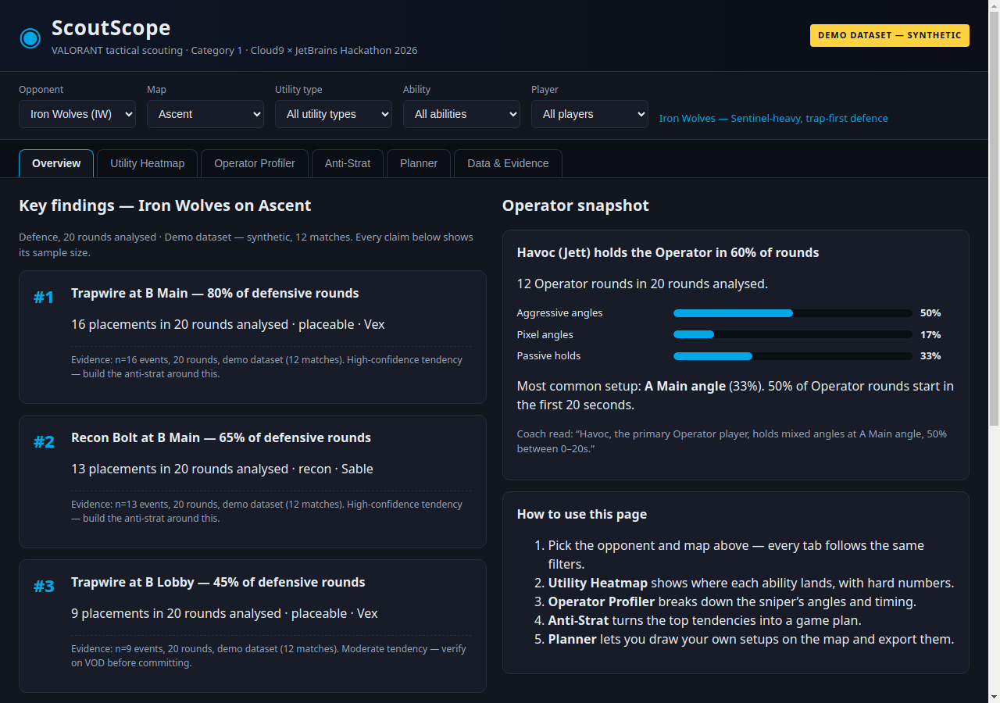
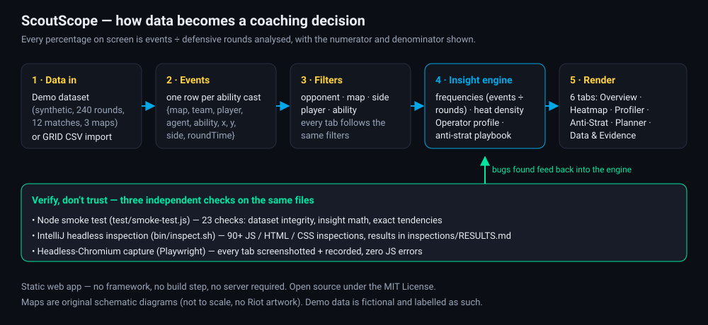

# ScoutScope — VALORANT Tactical Scouting for Cloud9 Coaches

[](LICENSE)
[](https://manes90.github.io/scoutscope/)
[](https://cloud9.devpost.com/)

**Category 1** · Cloud9 × JetBrains: Sky's the Limit Hackathon 2026
**Prize track:** Best of Category 1 — VALORANT Tactical Scouting, Utility Placement & Operator Profiler ($6,000 + GDC trip)
**Built with:** JetBrains **IntelliJ IDEA 2025.3 (free core)** — see [JETBRAINS.md](JETBRAINS.md)

**[▶ Watch the 87-second demo video](video/clip.mp4)** (on-screen text, no
voiceover yet — narration to be recorded) · **[▶ Try the live demo](https://manes90.github.io/scoutscope/)**



ScoutScope turns opponent match data into visual, coach-ready tactical
insights. Before every match, coaches spend hours scrubbing VODs to track
where opponents place trapwires or where their star Duelist sets up with a
sniper. ScoutScope answers those questions in one glance: clear heatmaps with
hard numbers, an Operator tendency profiler, and data-backed anti-strats.

## What it does

- **Overview** — the top 5 tendencies for the selected opponent + map, each
  with its sample size ("Sky Smoke at B Long — 13 placements in 12
  defensive rounds, 1.08 per round"), plus an Operator snapshot.
- **Utility Heatmap** — every ability placement plotted on an original
  schematic map, with a density heat overlay and a frequency table
  ("13/12 rounds — 1.08 per round" style hard numbers). Filter by opponent, map, player,
  agent, ability, utility type and side.
- **Operator Profiler** — who buys the Operator, how often, aggressive vs.
  pixel vs. passive angles, round-time distribution (0–20s / 20–40s / 40s+),
  and favourite setup spots on the map.
- **Anti-Strat** — each measured tendency turns into a concrete counter
  (e.g. clear the trapped lane 5s before the execute), with the evidence
  that supports it. Includes a self-scouting note.
- **Planner** — coaches click the map to draw their own setups, save them
  locally, and export them as JSON for the team.
- **Data & Evidence** — the full provenance (series, sample sizes,
  methodology summary), and a **GRID-format CSV import** so coaches can
  load any other match; the analysis engine is data-source agnostic.

## How it works



Data in (real GRID aggregates, or a GRID CSV import) → one event row per ability
cast → shared filters (opponent · map · side · player · ability) → insight
engine (frequencies, heat density, Operator profile, anti-strat playbook)
→ six tabs. Three independent checks guard the same files: Node smoke test
(38/38), IntelliJ headless inspection (90+ checks, see
[inspections/RESULTS.md](inspections/RESULTS.md)), and a Playwright
tab-walk (2 teams × 2 maps × 6 tabs, zero JS errors).

## Run it

No build step, no dependencies, no server required:

```bash
# Option 1 — open directly
open index.html

# Option 2 — serve locally
python3 -m http.server 8000
# then visit http://localhost:8000
```

## Real data — read this

The built-in dataset is **real GRID telemetry**: Cloud9 vs FURIA, VCT
Americas Stage 2 2025, 2025-07-18 (series 2819676) — Haven 13–5, Bind
13–4, 35 rounds won, 1,013 ability casts positioned, 8 Operator rounds.
Source: the official Cloud9 starter repo (GRID feed + ability supplement +
meta CSVs, no login or API key). The starter data is proprietary, so only
**aggregates** are committed (counts by team/map/side/ability/location/
player) — no per-event rows, no raw data files. The engine expands the
aggregates into rows at runtime with every marginal preserved exactly.
Full provenance, including the feed-vs-CSV side discrepancy and the
abandoned round, is in [METHODOLOGY.md](METHODOLOGY.md). One series means
small samples (thinnest: 5 defensive rounds) — every claim shows its n.

Maps are **original schematic diagrams** drawn for this tool (not to scale,
no Riot artwork or assets). Agent and ability names are used descriptively
for scouting, exactly as the official category blueprint does.

## Project layout

```
index.html          entry point
css/style.css       all styling (no framework)
js/data.js          real-data aggregates + map schematics + anti-strat playbook
js/app.js           filters, insights engine, renderers, planner, CSV import
tools/build-data.py regenerates the REAL block in js/data.js from the extraction
test/smoke-test.js  node smoke test (node test/smoke-test.js)
test/tab-walk.py    Playwright tab-walk: every tab under every filter, zero JS errors
METHODOLOGY.md      how every number is computed
AI_SHOWCASE.md      bonus-prize write-up (AI-powered workflow story)
DEVPOST_DRAFT.md    submission draft for Devpost
JETBRAINS.md        how the free IntelliJ core was used (inspection, evidence)
inspections/        inspection profile + RESULTS.md (triage of the 454 findings)
docs/architecture.svg   data-flow diagram (also shown above)
video/              demo video: script.md, steps.json, footage/, clip.mp4 (90 s)
screenshot-*.png    annotated screenshots of all six tabs (numbered callouts)
.idea/              IntelliJ IDEA project files (committed as tool-use evidence)
```

## Tests

```bash
node test/smoke-test.js   # dataset integrity + insight math + file checks (38/38)
~/workspace/.venvs/playwright/bin/python test/tab-walk.py  # 36 tab renders, zero JS errors
```

## JetBrains tools used

- **IntelliJ IDEA 2025.3 (free core)** — the project was created
  and developed in it; its headless code inspection (`bin/inspect.sh`) is
  part of verification. Details in [JETBRAINS.md](JETBRAINS.md).
- No paid JetBrains product, trial, or licence was used. The hackathon's free
  All Products Pack / AI Ultimate codes (issued on registration) were not
  needed for this build.

## License

MIT — see [LICENSE](LICENSE).
